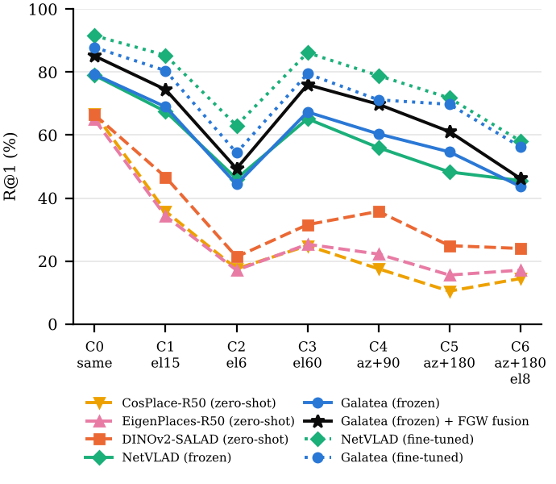

# Galatea: optimal-transport visual place recognition for the lunar surface

Code, benchmark and paper source for

> **Galatea: Merging Local and Global Descriptors with Optimal Transport for Visual Place Recognition on Extraterrestrial Surfaces**
> Raunak Sarbajna and Christoph F. Eick, University of Houston. Manuscript in preparation, targeting IEEE RA-L.

Galatea is a two-stage visual place recognition (VPR) system for GNSS-denied lunar surface navigation:

1. **Global retrieval.** Frozen DINOv2 tokens are assigned to clusters and a dust-bin by a *semi-relaxed
   unbalanced optimal-transport* problem. Its relaxation λ recovers NetVLAD (λ=0) and SALAD (λ=1) exactly.
2. **Local re-ranking.** The top-K candidates are re-scored with a training-free *partial fused
   Gromov–Wasserstein* matching of SuperPoint keypoints, which rewards matches that keep their relative
   layout. A saturating score then fuses this local evidence with the global similarity.

The repository also contains **LunarSim-VPR**, a procedural, physically motivated lunar renderer and benchmark.
In it the *same* query poses are rendered under seven Sun conditions, so changes in recall are caused by
illumination alone.



## Key results (LunarSim-VPR test set, 3 unseen scenes, 3,150 paired queries)

| Method | Recall@1 (%) | R@1, hardest Sun changes (%) |
|---|---|---|
| CosPlace-R50, zero-shot | 26.8 | 14.1 |
| EigenPlaces-R50, zero-shot | 28.1 | 16.6 |
| DINOv2-SALAD, zero-shot | 35.8 | 23.4 |
| GeM head, frozen backbone | 31.5 ± 0.4 | 21.7 |
| NetVLAD head, frozen backbone | 58.2 ± 0.7 | 46.7 |
| SALAD head (λ=1), frozen backbone | 59.4 ± 0.7 | 48.6 |
| Galatea head (learned λ), frozen backbone | 59.8 ± 0.8 | 47.6 |
| Galatea (frozen) + FGW global–local fusion | 66.1 ± 0.1 | 52.2 (seed 0) |
| GeM, fine-tuned backbone | 50.7 ± 3.2 | 42.0 |
| **NetVLAD, fine-tuned backbone** | **76.4 ± 0.7** | **64.3** |
| SALAD (λ=1), fine-tuned backbone | 73.5 ± 0.5 | 62.2 |
| λ=0 OT head, fine-tuned backbone | 73.1 ± 1.1 | 61.9 |
| Galatea (learned λ), fine-tuned backbone | 71.3 ± 1.2 | 60.1 |
| Galatea (fine-tuned) + FGW fusion | 74.5 ± 0.8 | 63.0 |
| **NetVLAD (fine-tuned) + FGW fusion** | **79.4** (seed 0) | **67.7** |

Trained rows give the mean ± std over 3 seeds. "Frozen": only the aggregation head is trained; "fine-tuned":
the last four DINOv2 blocks are trained with the head (GPU). "Hardest" averages conditions C2 (grazing Sun),
C5 (shadows reversed) and C6 (both). The main findings:

- Illumination-diverse training is worth +24 points over the best terrestrial model with a frozen backbone.
  A single training Sun direction costs 13.6 points frozen and 21.5 points fine-tuned.
- Joint backbone fine-tuning adds 11–19 points of R@1 for every head.
- With a frozen backbone, balanced and unbalanced OT assignment perform alike; the paper proves why (after
  intra-normalisation the descriptor sees the transport plan only through per-token weights). With
  fine-tuning, the end points λ ∈ {0, 1} beat a learned intermediate λ, and NetVLAD is the best head.
- Fusing local and global evidence adds 3–7 points for every local matcher. Re-ranking by local evidence
  alone helps little.

The full tables and ablations are in [`docs/RESULTS.md`](docs/RESULTS.md).

> **Limitation.** All results come from simulation. The relative comparisons use paired queries on unseen
> scenes, but the absolute numbers are not on-Moon predictions. Frozen-backbone runs were done on a 2-core CPU
> and reproduced on GPUs; fine-tuning runs used NVIDIA Tesla P40 GPUs.

## Repository layout

```
src/            Python modules and entry points (renderer, models, training, re-ranking, analysis)
scripts/        setup.sh (third-party code and weights), run_experiments.sh, reproduce_all.sh
data/lunarsim/  LunarSim-VPR rendered images + metadata (features are NOT included; regenerate them)
results/        per-run metrics, trained aggregation heads (head.pt), re-ranking scores, summaries
paper/          LaTeX source of the manuscript and supplement, figures, compiled PDFs
docs/           BENCHMARK.md, METHOD.md, RESULTS.md, REPRODUCE.md
```

## Installation

```bash
git clone https://github.com/RaunakDune/galatea-lunar-vpr
cd galatea-lunar-vpr
python3 -m venv .venv && source .venv/bin/activate
pip install -r requirements.txt
bash scripts/setup.sh        # clones DINOv2 / SALAD / LightGlue code and downloads official weights
```

Every path is set in [`src/paths.py`](src/paths.py), and each one can be overridden with an environment
variable: `GALATEA_DATA`, `GALATEA_RESULTS`, `GALATEA_WEIGHTS`, `GALATEA_EXT` and `GALATEA_PAPER`.

## Quick start

Render a lunar view under any Sun direction:

```python
import sys; sys.path.insert(0, "src")
import numpy as np
from lunarsim import Terrain, render
from PIL import Image

T = Terrain(seed=7)                                    # procedural regional + local DEM
img = render(T, x0=0.0, y0=0.0, yaw_deg=45.0,          # rover pose (m, deg)
             az_deg=135.0, el_deg=10.0,                # Sun azimuth / elevation (deg)
             rng=np.random.default_rng(0))
Image.fromarray(img).save("view.png")
```

Use the OT assignment on your own tokens:

```python
import torch
from aggregators import OTHead
head = OTHead(C=768, m=64, l=128, mode="learn")        # 'balanced' = SALAD, 'softmax' = λ=0
desc = head((torch.randn(2, 768, 15, 20), torch.randn(2, 768)))   # -> [2, 8448], L2-normalised
```

Evaluate on the shipped benchmark. This extracts features first (about 1.5 h on 2 CPU cores):

```bash
cd src
python3 extract.py              # writes data/lunarsim/*/t*/feats.pt
python3 zeroshot.py test val    # terrestrial baselines
python3 train_eval.py --name galatea_s0 --head ot --mode learn --steps 500 --P 24 --eval_split val,test --save_desc
```

Joint backbone fine-tuning needs a GPU (about 25 min per run on a Tesla P40):

```bash
python3 train_ft.py --name ft1e-4_galatea_s0 --head ot --mode learn --bb_lr 1e-4 --steps 1000 --device cuda:0 --save_desc
```

On a multi-GPU machine without a scheduler, `scripts/gpu_queue.sh` runs a job list across GPUs, and
`scripts/rerank_parallel.sh` spreads re-ranking over CPU cores.

To reproduce everything (every number, table, figure and the paper PDF), run `bash scripts/reproduce_all.sh`.
Details are in [`docs/REPRODUCE.md`](docs/REPRODUCE.md).

## Related project: DESPINA

[DESPINA](https://doi.org/10.5194/isprs-annals-XI-2-2026-881-2026) (Nelson-Archer, Sarbajna and Eick,
ISPRS Annals 2026) synthesises photorealistic lunar horizon views for a given location and heading. It
works from LRO elevation models with DEM-conditioned diffusion (SDXL with a lunar LoRA, plus depth and
soft-edge ControlNets). DESPINA and LunarSim complement each other:

- LunarSim gives exact ground truth and explicit control of the Sun direction, for controlled
  illumination studies.
- DESPINA gives realistic appearance for *real* sites, but does not expose Sun-direction control.

Code: [UH-DAIS/DESPINA_technical_details](https://github.com/UH-DAIS/DESPINA_technical_details) ·
Data: [UH-DAIS/DESPINA_dataset](https://github.com/UH-DAIS/DESPINA_dataset)

**Planned:** a real-imagery evaluation of Galatea. Its reference database will be DESPINA-synthesised
views of LRO elevation-model poses at the Apollo 17 Taurus–Littrow site, and its queries will be Apollo 17
surface photographs taken at stations with published coordinates. This depends on the DESPINA diffusion
weights, which are not yet public.

## Documentation

- [`docs/BENCHMARK.md`](docs/BENCHMARK.md): the LunarSim-VPR dataset card (renderer, splits, protocol, file format).
- [`docs/METHOD.md`](docs/METHOD.md): the formulation and the five propositions, with pointers into the code.
- [`docs/RESULTS.md`](docs/RESULTS.md): all result tables and how they are generated.
- [`docs/REPRODUCE.md`](docs/REPRODUCE.md): step-by-step reproduction, compute budget, troubleshooting.

## Citation

```bibtex
@misc{sarbajna2026galatea,
  title  = {Galatea: Merging Local and Global Descriptors with Optimal Transport for
            Visual Place Recognition on Extraterrestrial Surfaces},
  author = {Sarbajna, Raunak and Eick, Christoph F.},
  year   = {2026},
  note   = {Manuscript in preparation. Code: https://github.com/RaunakDune/galatea-lunar-vpr}
}
```

GitHub's "Cite this repository" button uses [`CITATION.cff`](CITATION.cff).

If you use DESPINA-generated imagery, please also cite:

```bibtex
@article{nelsonarcher2026despina,
  title   = {{DESPINA}: Synthesis of High-Fidelity Planetary Horizon Reconstructions Using {DEM}-Guided Diffusion},
  author  = {Nelson-Archer, Adam and Sarbajna, Raunak and Eick, Christoph F.},
  journal = {ISPRS Annals of the Photogrammetry, Remote Sensing and Spatial Information Sciences},
  volume  = {XI-2-2026},
  pages   = {881--890},
  year    = {2026},
  doi     = {10.5194/isprs-annals-XI-2-2026-881-2026}
}
```

## License and third-party code

The code in this repository is released under the [MIT License](LICENSE). The LunarSim-VPR images are
synthetic renders produced by this code and are covered by the same license. The two Apollo 11 photographs
used in a paper figure are NASA images in the public domain.

No third-party model weights or code are redistributed. `scripts/setup.sh` downloads them from their
official sources, each under its own license:

| Component | Used for | License |
|---|---|---|
| [DINOv2](https://github.com/facebookresearch/dinov2) | backbone architecture | Apache-2.0 |
| [SALAD](https://github.com/serizba/salad) | pretrained DINOv2-SALAD weights; aggregator loaded at run time for the zero-shot baseline | GPL-3.0 |
| [CosPlace](https://github.com/gmberton/CosPlace), [EigenPlaces](https://github.com/gmberton/EigenPlaces) | zero-shot baselines | MIT |
| [LightGlue / SuperPoint](https://github.com/cvg/LightGlue) | keypoints and learned-matcher baseline | Apache-2.0 (SuperPoint weights: non-commercial, see their repo) |

`src/nets.py` imports SALAD's GPL-3.0 aggregator from `third_party/` at run time to reproduce the zero-shot
baseline. If you redistribute a combined work that includes it, GPL-3.0 terms apply to that work. The OT
assignment in `src/aggregators.py` is an independent implementation.

## Author

**Raunak Sarbajna**, Department of Computer Science, University of Houston.
ORCID [0000-0002-3184-7226](https://orcid.org/0000-0002-3184-7226) ·
[Google Scholar](https://scholar.google.com/citations?user=Ypn_raEAAAAJ&hl=en).
Advisor: Dr. Christoph F. Eick.
