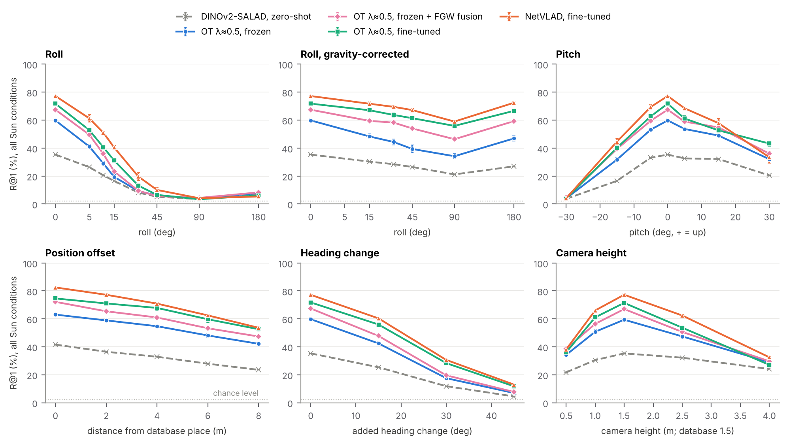

# Robustness to camera roll, pitch and viewpoint

This study is Section SII of the paper's supplementary material (`paper/supplement.pdf`), with a summary in
the main paper's limitations.

These tests ask how the place-recognition pipeline of the paper behaves when the query camera is
tilted or stands somewhere other than where the database was recorded. All numbers are Recall@1 (%)
on the LunarSim-VPR test set (3 unseen scenes, 150 places each), averaged over all 7 Sun conditions
(3150 queries per variant). Chance level is 2.2%. The database is always the original, upright one.



## Protocol

- **Same queries, one factor changed.** Every variant re-renders the benchmark queries at exactly the
  benchmark poses (replayed from the generator's random stream) and changes one factor: roll, pitch,
  distance from the database place, heading, or camera height.
- **Exact tilted views.** The renderer casts rays column by column, which is exact only for an upright
  camera. A tilted camera sees the same rays re-projected, so its image is an upright image with the
  same focal length warped by the rotation homography K R K⁻¹. This holds independently of scene depth
  (`src/tilt.py`). To keep tilted images as sharp as native ones, the upright source is rendered at 3×
  resolution, with the micro-relief detail level of the native resolution, and point-sampled. Checks:
  - with no tilt the module reproduces the benchmark renderer pixel for pixel;
  - a 0.01° roll through the resampling path differs from the native image by 0.15 grey levels (mean).
- **Roll axis.** Roll is a rotation about the camera's central viewing direction, so an upside-down
  camera sees the same scene upside down. The benchmark camera's principal point lies above the image
  centre, so rolling about the optical axis itself would swing the view into the sky.
- **Gravity correction.** "Roll, gravity-corrected" simulates levelling the image with an IMU: the
  upright view, masked to the part of the scene the rolled camera actually sees (black elsewhere).
  15° keeps 89% of the frame, 90° keeps 74%, and 180° keeps 88%.
- **Models.**
  - Zero-shot DINOv2-SALAD.
  - Frozen-backbone Galatea and NetVLAD heads (the GPU runs of Table III, 3 seeds each).
  - Fine-tuned Galatea and NetVLAD, retrained with the paper's settings so that the fine-tuned backbone
    could be saved. Their upright test R@1 is 71.3 and 77.0 (paper: 71.3 and 76.4).
  - Stage-2 fusion (FGW and MNN+MAGSAC++) on frozen Galatea seed 0, with the paper's validation-tuned
    β and κ, not re-tuned for any variant.
- **Baseline.** The re-rendered upright queries (`roll_0`, fresh noise) reproduce the paper: frozen
  Galatea 59.8 ± 1.1, fine-tuned NetVLAD 77.2 ± 0.5.
- **Statistics.** Mean ± std over 3 seeds; paired bootstrap CIs (2000 resamples of queries) for
  differences from the upright baseline.

## Results (R@1, %)

| Variant | Zero-shot SALAD | Galatea, frozen | Galatea, fine-tuned | NetVLAD, fine-tuned | Galatea frozen (seed 0) + FGW | Galatea frozen (seed 0) + MNN+MAGSAC++ |
|---|---|---|---|---|---|---|
| Upright (baseline) | 35.3 | 59.8 ± 1.1 | 71.8 ± 1.2 | 77.2 ± 0.5 | 67.4 | 68.2 |
| Roll 1° | 33.0 | 56.1 ± 0.8 | 66.6 ± 1.3 | 73.6 ± 0.7 | 61.7 | 64.6 |
| Roll 5° | 26.4 | 41.1 ± 1.5 | 52.9 ± 0.9 | 61.3 ± 2.6 | 49.6 | 54.9 |
| Roll 15° | 16.5 | 19.5 ± 1.6 | 31.2 ± 0.8 | 40.5 ± 1.4 | 23.4 | 35.5 |
| Roll 45° | 5.2 | 6.1 ± 0.4 | 6.5 ± 0.6 | 10.1 ± 1.7 | 5.7 | 6.8 |
| Roll 90° | 3.5 | 4.0 ± 0.5 | 3.4 ± 0.6 | 4.1 ± 0.3 | 4.4 | 4.7 |
| Roll 180° | 6.9 | 7.8 ± 0.3 | 6.1 ± 0.5 | 5.4 ± 1.1 | 8.3 | 8.2 |
| Roll 45°, gravity-corrected | 26.5 | 39.4 ± 2.9 | 61.4 ± 1.2 | 67.2 ± 1.1 | 54.0 | 57.3 |
| Roll 180°, gravity-corrected | 26.9 | 46.9 ± 1.9 | 66.6 ± 0.5 | 72.4 ± 0.7 | 59.3 | 63.0 |
| Pitch −30° (down) | 3.7 | 4.0 ± 0.3 | 3.8 ± 0.3 | 4.0 ± 0.5 | 4.6 | 4.7 |
| Pitch −15° | 16.5 | 31.7 ± 1.5 | 40.2 ± 0.4 | 44.6 ± 2.4 | 39.4 | 43.6 |
| Pitch −5° | 33.1 | 53.2 ± 1.2 | 62.7 ± 1.4 | 69.4 ± 1.6 | 59.6 | 62.5 |
| Pitch +5° | 32.6 | 53.7 ± 1.1 | 61.1 ± 1.9 | 68.4 ± 0.9 | 58.9 | 63.0 |
| Pitch +15° | 32.2 | 49.0 ± 0.9 | 52.7 ± 3.3 | 57.8 ± 3.2 | 54.8 | 56.9 |
| Pitch +30° (up) | 20.5 | 32.1 ± 0.3 | 43.2 ± 1.8 | 33.5 ± 4.4 | 36.0 | 42.0 |
| Offset 0 m | 41.6 | 63.1 ± 0.6 | 74.6 ± 1.3 | 82.5 ± 0.3 | 72.2 | 72.8 |
| Offset 4 m | 32.9 | 54.8 ± 0.8 | 67.8 ± 2.1 | 70.9 ± 0.6 | 61.0 | 62.5 |
| Offset 8 m | 23.6 | 42.2 ± 1.0 | 52.6 ± 2.0 | 53.6 ± 0.9 | 47.4 | 47.6 |
| Heading +15° | 25.4 | 42.5 ± 1.1 | 56.0 ± 1.1 | 60.4 ± 0.2 | 47.8 | 49.3 |
| Heading +30° | 11.9 | 17.6 ± 0.6 | 28.4 ± 0.6 | 30.7 ± 0.7 | 19.6 | 20.4 |
| Heading +45°* | 4.5 | 7.0 ± 0.3 | 11.8 ± 0.8 | 13.0 ± 0.3 | 7.8 | 7.7 |
| Height 0.5 m | 21.8 | 34.2 ± 0.9 | 36.0 ± 1.7 | 38.2 ± 0.5 | 38.5 | 38.2 |
| Height 1.0 m | 30.5 | 50.8 ± 1.3 | 61.1 ± 1.6 | 66.0 ± 0.4 | 56.4 | 56.6 |
| Height 1.5 m (= database) | 35.3 | 59.4 ± 1.2 | 71.4 ± 1.1 | 77.3 ± 0.7 | 67.0 | 67.2 |
| Height 2.5 m | 32.2 | 47.5 ± 0.5 | 53.7 ± 1.4 | 62.4 ± 0.7 | 50.7 | 52.4 |
| Height 4.0 m | 24.2 | 29.0 ± 1.4 | 27.1 ± 1.8 | 32.5 ± 0.7 | 29.7 | 29.1 |

\* 70 of 3150 queries have no database image within 10 m and 60° of heading; they are excluded.

Notes on the variants:
- **Benchmark jitter.** Queries already carry heading noise σ = 10°, a position offset of up to 3 m
  (uniform over a 3 m disk) and a camera height of 1.35–1.7 m. The heading and height sweeps add to or
  replace these.
- **Offset sweep.** It fixes the distance to the place exactly, so "Offset 0 m" is easier than the
  benchmark.
- **More data.** All 33 variants, per-condition recall and paired CIs are in
  [`results/robust/summary.json`](../results/robust/summary.json).

## Findings

1. **Roll is the most damaging factor, and fine-tuning does not fix it.**
   - Small rolls: 1° costs frozen Galatea 4.0 points (paired 95% CI [2.4, 5.7]), 5° costs 18.7 and
     15° costs 44.
   - Large rolls: at 45° every model is below 11%, and at 90° and 180° below 9%, against a chance
     level of 2.2%. The terrestrial model is no better.
   - Fine-tuned models lose nearly as much (fine-tuned NetVLAD: −16 points at 5°, −37 at 15°).
   - The cause is the training data, not the aggregation: no training or database image is ever
     rolled, and DINOv2 features are not rotation-invariant.
2. **Levelling the image with gravity recovers most of the loss.**
   - At 180°, gravity correction brings frozen Galatea from 7.8% back to 46.9%, and fine-tuned NetVLAD
     from 5.4% to 72.4%.
   - The remaining gap comes from the black regions outside the rolled frame. They cost the frozen
     reference head 11–26 points but the fine-tuned models only 5–18.
   - Cropping to the largest upright rectangle, or training with such masks, would probably close
     much of the remaining gap. This has not been tested.
3. **Pitch is asymmetric, and the dust-bin helps when looking up.**
   - ±5° costs frozen Galatea 6–7 points and the fine-tuned models 8–11.
   - Looking down 30° fills the frame with ground within a few metres and loses the horizon; every
     model is at chance. Part of this may come from the simulator, which renders ground within a
     metre or two less faithfully (0.3 m terrain grid plus procedural micro-relief).
   - Looking up 30° leaves mostly sky. There Galatea is about 10 points ahead of NetVLAD with the
     frozen backbone (32.1 ± 0.3 vs 20.9 ± 1.4) and with the fine-tuned one (43.2 ± 1.8 vs 33.5 ± 4.4).
     This fits the dust-bin acting as a gate on sky tokens (Prop. 3), though NetVLAD also differs in
     its aggregation.
4. **Position matters gradually, heading sharply.**
   - Moving 8 m from the database place costs frozen Galatea 21 points relative to 0 m.
   - Adding 15° of heading costs 17 points and 30° costs 42.
   - Each place is in the database with a single heading, and about 70% of the frame shows nearby
     ground, which changes completely when the rover turns. A database with several headings per place,
     or panoramic imagery, is needed if the rover may return from another direction.
5. **Camera height should match the database.**
   - Relative to the upright baseline, 1.0 m and 2.5 m cost frozen Galatea 9 and 12 points; 0.5 m and
     4.0 m cost 26–31.
   - At 4 m, fine-tuning no longer helps (fine-tuned Galatea 27.1 vs frozen 29.0).
6. **Fusion keeps helping under moderate perturbations but cannot rescue failed retrieval.**
   - On frozen Galatea seed 0, fusion adds 4–12 points for small rolls, pitches and position offsets
     (6–7 points upright).
   - Under larger perturbations the right place is rarely among the ten candidates, and fusion adds
     nothing.
   - Under roll, MNN+MAGSAC++ fusion holds up better than FGW (35.5% vs 23.4% at 15°). FGW's layout
     term is invariant to rotation, but its appearance term (SuperPoint descriptors) is not.

**Practical implication for a rover:** level the image with the IMU before retrieval, record the
database at the operating camera height and with several headings per place. Position offsets of a few
metres cost some accuracy (frozen Galatea: −5 points at 4 m) but do not break retrieval.

## Reproducing

```bash
python src/gen_robust.py --procs 24        # render all variants (data/lunarsim/robust/)
python src/train_ft.py ... --save_backbone # fine-tuned runs whose backbone can be reloaded
python src/robust_eval.py --variants ... --frozen_dir <runs> --ft <ft runs> --device cuda:0
python src/robust_rerank.py --variants ... --procs 30
python src/robust_report.py && python src/robust_plot.py
```
